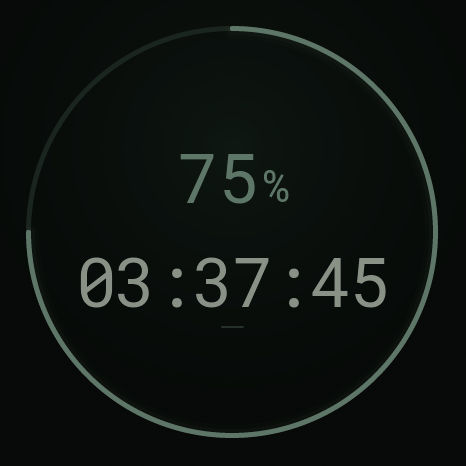

# Reset Ring · Codex StopWatch

把 Codex 的**剩余额度和重置倒计时**放到 M5Stack StopWatch 上，随手一看就知道还剩多少、什么时候重置，无需反复打开电脑查询。

电脑上的 Python Bridge 读取当前登录账号的限额，通过蓝牙发送给手表；

<p align="center"></p>

> 图为生产 LVGL 代码渲染的模拟数据。

## 项目解决了什么

- **额度一眼可见**：在 5H 与 Weekly 两个限额窗口之间切换，一次只展示一个窗口。
- **区分额度和时间**：圆环显示剩余额度，中央时间显示距离重置还有多久。
- **减少查表操作**：默认每 5 分钟自动同步，也可通过手表按键请求刷新。
- **断线继续计时**：蓝牙断开后保留最后的时间锚点，本地倒计时继续运行，重连后重新同步。
- **适合不同摆放角度**：中央文字支持任意角度转正，姿态稳定后再平滑调整，外围圆环固定；接近平放时保持最近方向。
- **不把未知当满额**：缺失数据不会显示成 100%，倒计时到零也必须等待服务端确认新周期。

## 支持的设备与系统

| 部分 | 当前支持范围 |
| --- | --- |
| 手表 | M5Stack StopWatch，ESP32-S3、16MB Flash、8MB PSRAM；已真机刷入验证 |
| Bridge：macOS / Apple Silicon | **已验证**；支持蓝牙同步和 LaunchAgent 登录自启动 |
| Bridge：macOS / Intel | 尚未真机验证，不承诺完整兼容性 |
| Bridge：Linux | 尚未适配和验证；自启动脚本依赖 macOS `launchctl` |
| Bridge：Windows | **当前不支持直接运行**；需要替换 `fcntl` 文件锁、路径和自启动实现 |
| Web 设计预览 | 静态 HTML / CSS / JavaScript，可在支持容器查询和 `<dialog>` 的现代浏览器中查看 |

当前 Bridge 的正式使用说明针对 **macOS**。蓝牙库支持其他平台，不代表本项目已经完成对应系统适配。

## 快速开始：在 Mac 上连接已刷好的手表

### 1. 准备环境

- Python **3.11 或更高版本**。
- 已安装的 **Codex CLI**，终端中可运行 `codex`；使用要查看额度的 ChatGPT 账号登录。
- Mac 开启蓝牙，手表在附近并保持供电。

日常使用通过 BLE 连接，**不需要接 USB 串口，也不需要安装 ESP-IDF**。USB 只在刷机或串口调试时使用。

### 2. 下载项目并安装依赖

```bash
git clone https://github.com/spinachx64/reset-ring.git
cd reset-ring

python3 -m venv .venv
.venv/bin/python -m pip install -r requirements.txt
```

### 3. 登录并验证额度读取

```bash
codex login
.venv/bin/python -m bridge.main --once --provider app-server
```

成功时输出一行 JSON，其中 `h` 为 5H、`w` 为 Weekly，`u` 是**已使用**比例。手表显示的是 `100 - u`。服务端没有提供的窗口为 `null`。

此命令只读取额度，不连接蓝牙，也不会执行推理探测。仅使用 API Key 登录时，不应期待得到这里展示的 ChatGPT 套餐限额。

### 4. 启动蓝牙同步

```bash
.venv/bin/python -m bridge.main
```

首次运行时允许系统请求的蓝牙权限。Bridge 自动查找广播名称为 `Codex Watch` 或提供 NUS 服务的设备；正常日志会出现 `BLE connected` 和 `quota updated`。

按 `Ctrl+C` 停止前台程序。需要指定某一只设备时可传入 `--device UUID`。

## 手表怎么操作

| 操作 | 行为 |
| --- | --- |
| 右键短按 | 切换 5H / Weekly；灰绿为 5H，暗金为 Weekly |
| 左键短按 | 请求刷新；轻振动和百分比短暂淡化作为反馈 |
| 两键同时长按 | 返回原厂主页 |
| 在主页点按第一项 Codex 图标 | 重新进入倒计时表盘 |
| 倾斜或转动手表 | 稳定约 0.28 秒后平滑转正，快速运动时暂缓调整，圆环固定 |

模式选择会保存到 NVS，重启后恢复。额度没有变化时，左键刷新后数字保持不变是正常现象。接近平放或合加速度异常时会锁定最近方向；这里使用的是加速度重力判断，不是平放状态下的指南针功能。

## 登录自启动与日志

先用 `Ctrl+C` 停止前台 Bridge，再执行：

```bash
bash scripts/setup_autostart.sh
```

脚本会创建并立即启动 `com.spinach.codex-stopwatch` LaunchAgent，以后登录 Mac 时自动启动，进程异常退出后会重启。

```bash
# 查看日志；单份约 2MB，保留最多 4 份
tail -f ~/Library/Logs/CodexStopWatch/bridge.log

# 重启
launchctl kickstart -k gui/$(id -u)/com.spinach.codex-stopwatch

# 停止本次加载
launchctl bootout gui/$(id -u)/com.spinach.codex-stopwatch
```

如需取消以后登录时自启动，停止后将 `~/Library/LaunchAgents/com.spinach.codex-stopwatch.plist` 移出 `LaunchAgents` 目录。

项目目录、虚拟环境或 Codex CLI 路径改变后，需要重新运行安装脚本。建议把项目放在 Mac 本地磁盘；放在外置磁盘时，登录后该磁盘必须已挂载。锁屏可继续运行，系统睡眠期间同步会暂停，唤醒后自动重连。

## 配置与数据行为

| 参数 | 用途 |
| --- | --- |
| `--interval 300` | 自动查询周期，单位秒，默认 300，最小 5 |
| `--provider app-server` | 仅使用 App Server，关闭 WHAM 回退 |
| `--provider wham` | 仅使用兼容接口 |
| `--codex /path/to/codex` | 指定 Codex CLI 路径 |
| `--device UUID` | 指定 macOS 蓝牙设备 UUID |
| `--state /path/to/state.json` | 指定本地缓存与序号文件 |
| `--log-file /path/to/bridge.log` | 输出轮转日志 |
| `--enable-probe` | 明确授权缺失 5H 时尝试一次真实 Codex 请求 |

默认状态文件位于 `~/Library/Application Support/CodexStopWatch/state.json`，同一状态文件只允许一个 Bridge 进程使用。手动刷新最短间隔为 5 秒；查询失败保留缓存、标记陈旧并退避重试。

数据优先来自 [Codex App Server 的 `account/rateLimits/read`](https://learn.chatgpt.com/docs/app-server)，失败时兼容回退到 WHAM 内部接口。窗口按 300 / 10080 分钟识别，不盲信 primary / secondary 的顺序。账号实际返回哪些窗口取决于数据源。

**5H 缺失时默认显示未知。** 只有显式使用 `--enable-probe` 才会执行一次 `codex exec` 真实请求，可能消耗使用量。成功后重查，仍无官方重置时间才采用完成时刻加 5h 的估算值，并以未知百分比、灰色虚线环区分。尝试标记在请求前持久化，重启不会自动重复探测。

重置时间为秒级；即使倒计时归零，也不会假定额度已回满。超过有效期的数据会降低圆环亮度或标为陈旧，等待服务端确认。

### OLED 防烧屏

额度表盘自动将圆环与文字每分钟换一个位置，在中心附近 ±4 像素的 5×5 网格中循环，25 分钟一轮，不改变读数与重力朝向。连续 10 分钟没有按键或有效姿态变化时，前景亮度降至约 70%；左键刷新、右键切换或姿态转正后恢复。倒计时跳秒、蓝牙同步不会打断降亮。

保护仅作用于本应用，保留低亮度配色与暗底盘。像素位移和降亮可以减轻长期静态显示的老化，不能保证 OLED 永不烧屏。

## 首次刷机与固件开发

本项目基于原厂 UserDemo 增加应用，**会替换当前固件**。刷机前备份整片 Flash，并保管好自己的恢复镜像。

已验证的构建环境为 PlatformIO 55.03.312 / ESP-IDF **5.5.5**、LVGL 9.5.0、Mooncake 2.3.3。原始 spec 建议 5.5.4，实际验证使用 5.5.5。需要 Git、Python、PlatformIO 和支持数据传输的 USB 连接。

```bash
# pio 已安装并可在 PATH 中找到；也可用 PIO_BIN 指定可执行文件
bash scripts/build.sh

# 查看实际串口后替换下面的示例
bash scripts/build.sh -t upload --upload-port /dev/cu.usbmodemXXXX
```

集成脚本把原厂工程准备在 git 忽略的 `build-firmware/`，复制应用并注册启动入口，保留原厂主页和其他应用。也可以运行 `bash scripts/install_firmware.sh` 后，在已配置的 ESP-IDF 环境中执行 `idf.py build`。

原厂基线固定为 `83de653c0be4e51e82079bee2386b90fb0538a25`；组件版本记录在 [firmware/component-revisions.json](firmware/component-revisions.json)。首次构建需要联网下载依赖。

恢复自己的完整 16MiB 镜像：

```bash
# 所选 Python 环境需要安装 esptool；此操作会覆盖设备 Flash
ESPTOOL_PYTHON=python3 bash scripts/restore_firmware.sh \
  /dev/cu.usbmodemXXXX /absolute/path/to/your-backup.bin
```

## 参考与许可

- [cc-island](https://github.com/alexjc-tech/cc-island)：BLE 和参考实现，MIT 许可，见 [保留的许可](docs/cc-island-LICENSE)。
- [M5StopWatch-UserDemo](https://github.com/m5stack/M5StopWatch-UserDemo)：原厂工程，见 [原厂许可](docs/M5Stack-LICENSE)。
- Roboto Mono 数字字体：SIL OFL 1.1，见 [OFL.txt](firmware/app_codex_timer/fonts/OFL.txt)；字体转换器固定为 `lv_font_conv@1.5.3`。
